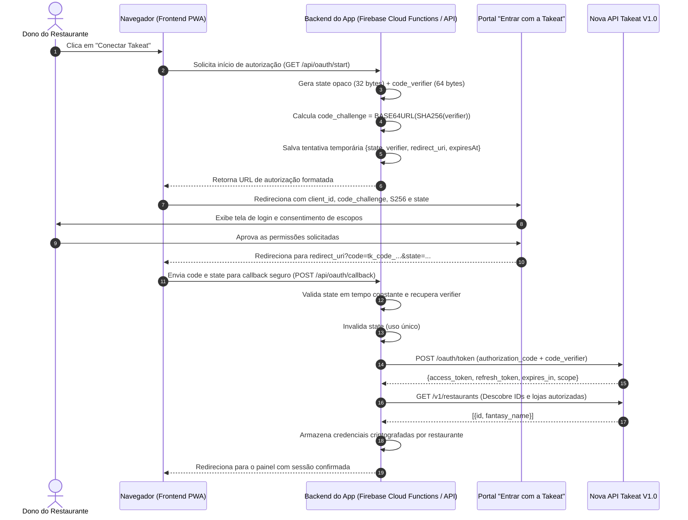

# Especificação Técnica: Aplicativo Rota Certa para a Takeat Store

> **Documento Canônico de Integração OAuth 2.0 com PKCE S256**  
> Em conformidade com as diretrizes oficiais da Takeat Nova API V1.0 e Takeat Store.  
> Fontes oficiais:  
> - https://docs.takeat.app/md/v1/takeat-store.md  
> - https://docs.takeat.app/md/v1/oauth.md  
> - https://docs.takeat.app/md/v1/oauth-agentes.md  
> - https://docs.takeat.app/openapi-v1.yaml  

---

## 1. Escopo Funcional do App e Fluxos Visíveis

### 1.1 Objetivo do Produto
O **Rota Certa** é uma plataforma completa de logística de entrega, gestão de motoboys próprios/terceirizados e roteirização inteligente para restaurantes.

Ao conectar o Rota Certa à sua conta Takeat através da **Takeat Store**, o restaurante obtém:
1. **Despacho Automático de Pedidos:** Captação instantânea de comandas e pedidos delivery finalizados no Takeat, sem necessidade de digitação manual de endereço ou comanda.
2. **Atribuição Inteligente de Entregadores:** Mapeamento em tempo real dos motoboys em rota e dos pedidos prontos para sair.
3. **Escala de Plantão & Trocas de Turno:** Calendário semanal de motoboys por turno (noite/almoço), com fluxo de solicitação e aceite de troca entre os próprios entregadores e exportação pronta para WhatsApp.
4. **Extrato Financeiro Automatizado:** Cálculo automático de taxas de entrega, comissões e totais por motoboy e por dia, com histórico consolidado e fechamento de caixa sem calculadora.
5. **Rastreamento e Roteirização Otimizada:** Cálculo de melhor sequência de paradas com integração para Waze, Google Maps e Valhalla.

### 1.2 Fluxos do Usuário
- **Jornada de Instalação:**
  1. O dono do restaurante visualiza o **Rota Certa** na Takeat Store.
  2. Clica em **Conectar / Instalar**.
  3. É direcionado para a tela oficial de consentimento `Entrar com a Takeat` (`TAKEAT_OAUTH_PORTAL_URL`), onde revisa a identidade do app e os escopos solicitados.
  4. Ao autorizar, é redirecionado de volta ao Rota Certa (`/oauth/callback`) já autenticado, sem jamais precisar digitar API Key, login ou senha da Takeat.
- **Jornada Operacional:**
  - O painel sincroniza automaticamente os pedidos ativos e despacha para os motoboys cadastrados.
- **Jornada de Desconexão:**
  - O restaurante pode desconectar o app no painel do Rota Certa ou no portal da Takeat, revogando o acesso imediatamente e cancelando as rotinas em segundo plano.

---

## 2. Arquitetura e Separação de Responsabilidades



> **Princípio de Segurança:**
> - O navegador **nunca** armazena `code_verifier`, `access_token` ou `refresh_token`.
> - A troca do código pelo par de tokens ocorre **estritamente entre o backend do Rota Certa e a Takeat API**.

---

## 3. Identificação do Cliente OAuth

- **Tipo de Cliente:** Cliente Público (`public client`), em estrito cumprimento às regras da Takeat Store.
- **Client ID:** Formato `tk_app_[ALFANUMERICO]` (fornecido pela Takeat após a aprovação da proposta no AI Builders).
- **Client Secret:** **Nenhum** (`client_secret` não existe nem é aceito no fluxo da Takeat Store).
- **Redirect URIs:**
  - Produção: `https://houseburger-entregas.web.app/oauth/callback`
  - Homologação / Teste Local: `http://localhost:3000/oauth/callback`

---

## 4. Geração de `state` e PKCE (S256)

1. **`code_verifier`:**
   - Gerado via CSPRNG (`crypto.randomBytes(64).toString('base64url')`).
   - Comprimento entre 43 e 128 caracteres Base64URL.
2. **`code_challenge`:**
   - Hash SHA-256 do `code_verifier`.
   - `BASE64URL(SHA256(code_verifier))`.
3. **`code_challenge_method`:**
   - Sempre `S256`.
4. **`state`:**
   - Gerado via CSPRNG (`crypto.randomBytes(32).toString('base64url')`).
   - Armazenado no backend com TTL de 10 minutos associado à sessão ou identificador temporário.

---

## 5. Tratamento do Callback

Ao receber `GET /oauth/callback`:
1. Se `error=access_denied`, o app trata como desistência consciente do usuário, exibe mensagem amigável e oferece botão de tentar novamente (sem registrar erro de sistema).
2. Se `code` e `state` estiverem presentes:
   - Valida existência do `state` no banco de tentativas pendentes.
   - Compara o `state` utilizando comparação em tempo constante (`crypto.timingSafeEqual`).
   - Verifica se o `state` não expirou.
   - Remove o registro do `state` imediatamente para prevenir reutilização (single-use).
   - Prossegue com a troca do token.

---

## 6. Troca do Código por Tokens (`POST /oauth/token`)

Requisição enviada exclusivamente pelo backend:
```http
POST https://public-api.takeat.app/oauth/token HTTP/1.1
Content-Type: application/x-www-form-urlencoded

grant_type=authorization_code
&client_id=tk_app_PRODUCAO_ID
&code=tk_code_RECEBIDO
&redirect_uri=https%3A%2F%2Fhouseburger-entregas.web.app%2Foauth%2Fcallback
&code_verifier=VERIFIER_RECUPERADO
```

Resposta tratada:
```json
{
  "access_token": "eyJhbGciOi...",
  "token_type": "Bearer",
  "expires_in": 900,
  "refresh_token": "tk_api_refresh_...",
  "scope": "table-sessions:read payment-methods:read brands:read"
}
```

---

## 7. Armazenamento e Criptografia por Instalação

- Os tokens são armazenados por `restaurant_id` isolado.
- Os campos sensíveis (`access_token`, `refresh_token`) são criptografados em repouso com algoritmo AES-256-GCM.
- O campo `expires_at` é calculado no momento do recebimento: `agora + expires_in segundos - margem_de_segurança_60s`.

---

## 8. Refresh Token Rotativo e Lock de Concorrência

- O `access_token` tem validade típica de 15 minutos (900s).
- Antes de cada chamada às rotas `/v1`, o backend verifica se `agora >= expires_at`.
- Se expirado, executa renovação:
  ```http
  POST https://public-api.takeat.app/oauth/token HTTP/1.1
  Content-Type: application/x-www-form-urlencoded

  grant_type=refresh_token
  &client_id=tk_app_PRODUCAO_ID
  &refresh_token=REFRESH_TOKEN_ATUAL
  ```
- **Lock Atômico:** Para evitar múltiplas renovações concorrentes no mesmo restaurante, implementa-se lock distribuído de 15 segundos por `restaurant_id`.
- O novo par recebido substitui o anterior atomicamente.

---

## 9. Revogação e Desconexão

Quando o restaurante clica em "Desconectar":
1. O backend envia requisição de revogação:
   ```http
   POST https://public-api.takeat.app/oauth/revoke HTTP/1.1
   Content-Type: application/x-www-form-urlencoded

   token=ACCESS_TOKEN_ATUAL
   ```
2. Remove atomicamente os tokens armazenados do restaurante.
3. Cancela qualquer job ou sincronização agendada para aquela loja.

---

## 10. Matriz de Operações e Escopos Mínimos

O Rota Certa adota o princípio de privilégio mínimo estrito. Nenhum escopo desnecessário (como estoque ou fiscal) é solicitado.

| Método | Endpoint | Escopo Mínimo | Justificativa de Uso |
| :--- | :--- | :--- | :--- |
| `GET` | `/v1/restaurants` | *(Nenhum adicional)* | Listar e identificar as lojas autorizadas pela credencial |
| `GET` | `/v1/table-sessions` | `table-sessions:read` | Sincronizar comandas, pedidos delivery, taxa de entrega, endereço e motoboy atribuído |
| `GET` | `/v1/table-sessions/{id}` | `table-sessions:read` | Obter detalhes de comanda específica para conferência de itens e taxa |
| `GET` | `/v1/payment-methods` | `payment-methods:read` | Identificar forma de pagamento (Dinheiro, PIX, Cartão) para fechamento de caixa do motoboy |
| `GET` | `/v1/brands` | `brands:read` | Identificar a marca/unidade de saída em operações multi-loja |

---

## 11. Isolamento Multi-Tenant por Restaurante

- **Banco de Dados:** Cada restaurante possui prefixo próprio (`/stores/{storeId}/...`).
- **Jobs de Sincronização:** Executados independentemente por restaurante com backoff exponencial individual.
- **Validação de Permissão:** Nenhuma requisição vinda do frontend pode consultar pedidos sem comprovar posse da sessão daquele `restaurant_id`.

---

## 12. Dados da Proposta para o AI Builders (Takeat Store)

### Identidade
- **Nome do App:** Rota Certa — Entregas & Motoboy
- **Desenvolvedor:** Rota Certa Tecnologia
- **Descrição Curta:** Gestão completa de motoboys, despacho inteligente de pedidos Takeat, escala de plantão e extrato financeiro por corrida.
- **Logo:** `https://houseburger-entregas.web.app/favicon.svg` (SVG/PNG alta resolução)

### Contato
- **E-mail de Suporte:** `suporte@rotacerta.app`
- **Telefone / WhatsApp de Suporte:** `+55 (73) 99847-1950`

### Confiança
- **Site Público:** `https://houseburger-entregas.web.app`
- **Política de Privacidade:** `https://houseburger-entregas.web.app/privacy.html`
- **Termos de Uso:** `https://houseburger-entregas.web.app/terms.html`

### Comercial
- **Modelo:** Assinatura Mensal
- **Período de Teste Obrigatório:** **7 dias de teste grátis** (sem cobrança durante a avaliação).
- **Preço Inicial Sugerido:** R$ 79,90/mês por restaurante (cobrança gerenciada pelo desenvolvedor).

### Escopos Solicitados na Proposta
- `table-sessions:read`
- `payment-methods:read`
- `brands:read`

---

## 13. Plano de Testes Automatizados

1. **Geração PKCE:** Validar que o `code_verifier` tem entropia adequada e `code_challenge` bate com `SHA256(verifier)` em base64url.
2. **Rejeição de State Inválido:** Simular callback com `state` desconhecido ou divergente e garantir retorno `403/invalid_state`.
3. **Consumo Único de State:** Garantir que o mesmo callback repetido rejeite a segunda tentativa.
4. **Tratamento de Recusa (`access_denied`):** Garantir redirecionamento suave com mensagem explicativa sem erros de runtime.
5. **Simulação de Refresh Concorrente:** Testar múltiplas requisições simultâneas para garantir que apenas um refresh ocorra e os tokens sejam compartilhados.
6. **Revogação:** Garantir que chamar desconexão invalida a sessão local e cancela chamadas subsequentes.

---

## 14. Critérios de Aceite para Publicação

- [x] Especificação técnica aprovada e alinhada com `oauth-agentes.md` da Takeat.
- [x] Nenhuma credencial ou segredo exposto no cliente ou no repositório.
- [x] Política de privacidade pública e em conformidade com a LGPD.
- [x] Redirect URIs de produção com HTTPS válido.
- [x] 7 dias de avaliação gratuita garantidos para todos os restaurantes instaladores.
